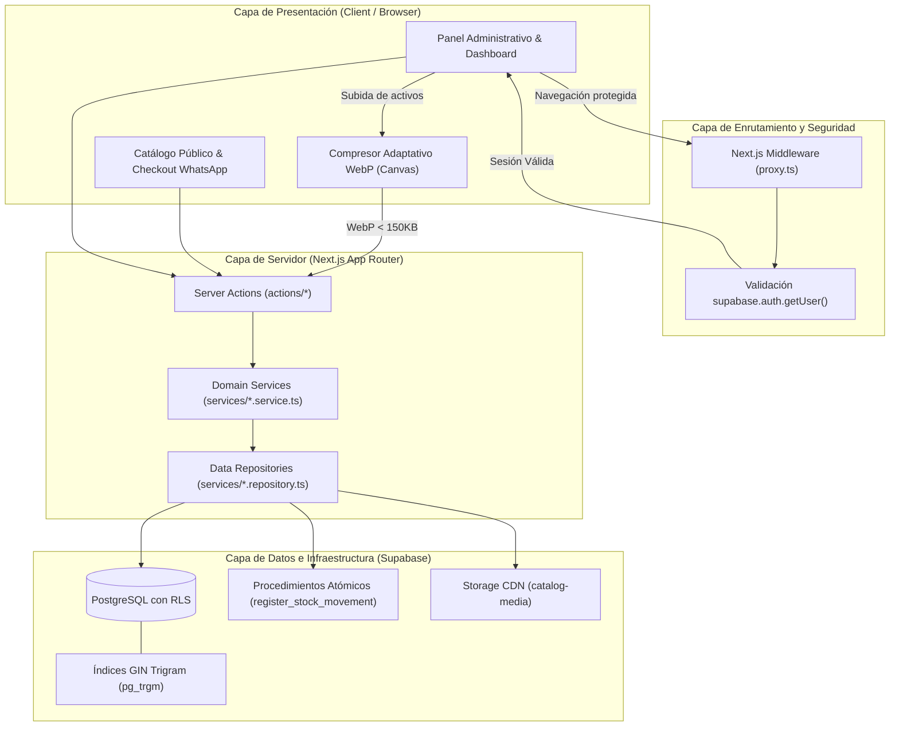
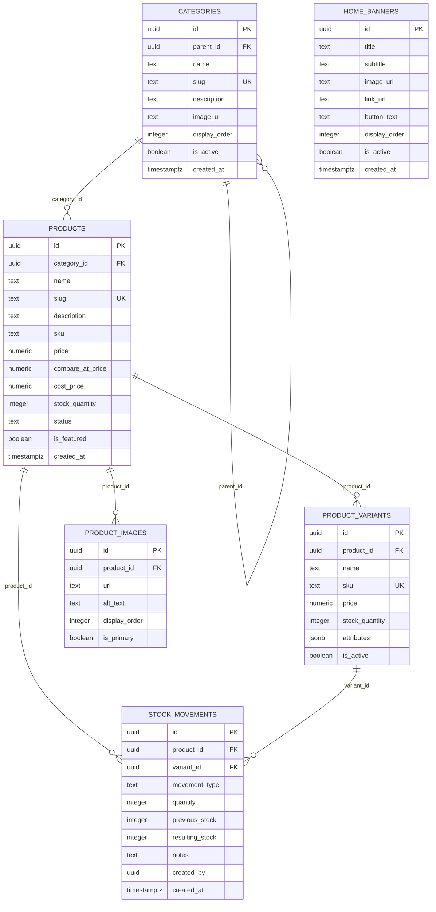

# El Pequeño Hong Kong 🏮

Plataforma de catálogo digital y gestión de inventario integral de alto rendimiento, diseñada con una estética editorial minimalista (inspirada en la experiencia visual de marcas streetwear como *Kith*) y concebida arquitectónicamente para operar con máxima eficiencia bajo las cuotas del **Free Tier de Supabase**.

El sistema combina una vitrina pública fluida orientada a la conversión directa por WhatsApp con un panel administrativo profesional dotado de auditoría transaccional de stock, compresión adaptativa de activos en el cliente y monitoreo de infraestructura en tiempo real.

---

## ⚡ Stack Tecnológico y Decisiones de Ingeniería

| Capa / Tecnología | Versión | Rol en el Sistema y Justificación Técnica |
| :--- | :--- | :--- |
| **Next.js** | `16.4.1` | **App Router + Turbopack**: Renderizado híbrido (SSR para SEO en fichas de productos y Client Components para interactividad). Server Actions para mutaciones sin API REST intermedia. |
| **React** | `19.3.0` | **Core UI**: Aprovechamiento de transiciones de estado concurrentes y hooks modernos de renderizado. |
| **TypeScript** | `5.x` | **Tipado Estricto**: Seguridad de tipos de punta a punta, desde esquemas de base de datos hasta componentes de interfaz. |
| **Tailwind CSS** | `v4.x` | **Diseño de Interfaz**: Nueva arquitectura de motor basada en CSS nativo con `@theme`, utilidades fluidas y cero runtime overhead. |
| **Radix UI & Lucide** | Últimas | Primitivas de UI accesibles (WAI-ARIA compliance) y sistema iconográfico consistente. |
| **Supabase (PostgreSQL)** | `Postgres 15+` | Base de datos relacional con **Row Level Security (RLS)**, funciones atómicas almacenadas (**RPCs**) e índices trigram (**`pg_trgm`**) para búsqueda difusa en tiempo real. |
| **Supabase Auth** | `@supabase/ssr` | Autenticación basada en cookies HTTP-only seguras con validación en el Edge Middleware. |
| **Supabase Storage** | `catalog-media` | CDN de distribución de imágenes con cabeceras inmutables `Cache-Control: 31536000` y recolección automática de basura. |
| **Testing** | Node.js Test Runner + TSX | Suite de pruebas unitarias y de integración rápida sin dependencias pesadas de runners externos. |

---

## 🏛️ Arquitectura del Sistema

La aplicación sigue una arquitectura en capas desacoplada (**Layered Architecture** / **Clean Boundary**), garantizando que las reglas de negocio no dependan de la presentación ni de librerías de infraestructura:



### Principios Arquitectónicos Aplicados:
1. **Separación de Responsabilidades (Service / Repository Pattern)**:
   - Los **Repositories** encapsulan las consultas a Supabase, RLS y llamadas a RPCs.
   - Los **Services** ejecutan validaciones de invariantes de negocio (no stock negativo, prevención de ciclos jerárquicos, reglas de precios).
   - Las **Server Actions** manejan la invocación desde la UI, controlan errores de transporte y orquestan la revalidación de caché (`revalidatePath`).
2. **Seguridad en el Edge sin Brechas**:
   - El middleware no se limita a verificar la presencia de un token JWT; invoca `supabase.auth.getUser()` para autenticar la sesión contra el servidor de Auth, mitigando vulnerabilidades de cookies manipuladas.
   - Control anti-*Open Redirect* mediante saneamiento estricto del parámetro `?redirect=`.
3. **Resiliencia Free-Tier**:
   - Cada imagen subida se procesa en el navegador a formato WebP adaptativo garantizando archivos `< 150 KB`.
   - Limpieza física de imágenes huérfanas en Storage cuando se edita o elimina un producto, banner o categoría.
   - Consultas de agregación en SQL para métricas de almacenamiento y tamaño de base de datos.

---

## 📂 Estructura de Directorios

```
elpequehongkong/
├── actions/                  # Next.js Server Actions (mutaciones de datos y revalidación)
│   ├── auth/                 # Login, logout y control de sesiones
│   ├── banners/              # Mutaciones y reordenamiento de banners de portada
│   ├── categories/           # Creación, actualización y borrado de categorías
│   ├── products/             # Catálogo, actualización masiva de precios y variantes
│   └── stock/                # Registro atómico de movimientos de inventario
├── app/                      # Rutas de la aplicación (Next.js App Router)
│   ├── (public)/             # Rutas públicas (Home, Catálogo, Ficha de producto)
│   │   ├── page.tsx          # Portada editorial con banners y lookbook
│   │   ├── catalogo/         # Catálogo interactivo con filtros sincronizados en URL
│   │   └── producto/[slug]/  # Ficha de detalle, zoom, selector y WhatsApp CTA
│   ├── admin/                # Panel de administración protegido (/admin/*)
│   │   ├── page.tsx          # Dashboard general, KPIs y monitor de cuotas
│   │   ├── categorias/       # ABM jerárquico de categorías y subcategorías
│   │   ├── portada/          # Gestor de banners de portada
│   │   ├── productos/        # Listado, filtros, modal de producto y precios en lote
│   │   └── stock/            # Auditoría histórica y registro de movimientos
│   ├── login/                # Acceso administrativo exclusivo
│   ├── layout.tsx            # Layout raíz con proveedores y fuentes
│   └── proxy.ts              # Proxy y middleware de autenticación en Edge
├── components/               # Componentes modulares y testeables
│   ├── admin/                # Componentes del backoffice (tablas, modales, alertas)
│   ├── auth/                 # Formularios y guards de autenticación
│   ├── public/               # Componentes de vitrina pública (navbar, cards, lookbook)
│   │   ├── CategoryGrid.tsx  # Grilla Lookbook editorial de categorías
│   │   ├── ProductCard.tsx   # Card de producto con badges automáticos
│   │   ├── ProductDetailView.tsx # Ficha técnica con zoom y selector
│   │   ├── PublicNavbar.tsx  # Navegación con efecto blur y drawer interactivo
│   │   ├── StoreLocationSection.tsx # Mapa, horarios, pagos y redes de la tienda
│   │   └── PublicFooter.tsx  # Footer institucional
│   └── ui/                   # Primitivas accesibles basadas en Radix UI
├── lib/                      # Clientes singleton e infraestructura base
│   ├── supabase/             # Clientes Supabase (Browser, Server, Middleware, Admin)
│   └── image-compression.ts  # Pipeline adaptativo de compresión WebP en Canvas
├── services/                 # Lógica de dominio desacoplada (Arquitectura Limpia)
│   ├── *.repository.ts       # Acceso a tablas de Supabase y RPCs
│   └── *.service.ts          # Reglas de negocio puras y validación de invariantes
├── supabase/                 # Recursos de base de datos
│   └── migrations/           # Esquemas DDL, funciones SQL, RLS e índices
├── tests/                    # Suite de pruebas automatizadas (75+ pruebas)
├── tickets/                  # Especificaciones funcionales completas (TICKET-01 a 09)
├── types/                    # Definiciones TypeScript de entidades y base de datos
└── utils/                    # Funciones puras (formato de moneda ARS, slugs, WhatsApp links)
```

---

## 💎 Módulos y Funcionalidades del Sistema

### 1. Vitrina Pública y Experiencia Editorial (Storefront)
- **Look & Feel Editorial**: Inspirado en la estética contemporánea de *Kith*, utilizando tipografía refinada, espacios generosos y fotografía a sangre.
- **Navbar Dinámico**: Barra superior transparente con transición a fondo con efecto cristal (`backdrop-blur-md`) al hacer scroll, menú lateral desplegable para categorías y acceso directo a contacto.
- **Home Dinámica con Banners**: Vitrina de novedades alimentada en tiempo real desde el panel de control, con soporte para títulos, subtítulos y llamadas a la acción (CTA) configurables.
- **Grilla Lookbook de Categorías**: Acceso visual directo a colecciones destacadas y categorías principales.
- **Catálogo Interactivo con URL Sync**:
  - Filtros multifactoriales: Búsqueda textual por nombre o SKU (con operador trigram `pg_trgm` en PostgreSQL), filtrado por categoría padre/hija, rango de precios y switch de stock disponible.
  - Sincronización instantánea de filtros en los `searchParams` de la URL, permitiendo compartir enlaces exactos sin pérdida de estado.
  - Debounce integrado para no saturar consultas ni degradar la tasa de cuadros por segundo.
- **Ficha de Producto de Alto Rendimiento (SEO ready)**:
  - Galería con visor principal interactivo, miniaturas ordenadas y selector de variantes dinámicas (talles, colores, medidas).
  - Generación dinámica de metadatos OpenGraph y Twitter Cards (`generateMetadata`) para indexación y previsualizaciones en redes sociales.
- **Checkout sin Fricción vía WhatsApp**:
  - Conversión directa sin barreras de registro de usuario o pasarelas de pago engorrosas.
  - Generación de mensaje parametrizado con nombre del producto, SKU, variante seleccionada, precio vigente y enlace directo de referencia.
- **Sección de Tienda Física y Comunidad**:
  - Ubicación geográfica con mapa interactivo embebido.
  - Horarios de atención comercial claramente detallados.
  - Medios de pago aceptados (efectivo, transferencias, billeteras virtuales, tarjetas).
  - Canales de contacto directo y redes sociales integradas.

### 2. Panel de Administración y Backoffice (/admin)
- **Dashboard y Monitor de Recursos Free Tier**:
  - Visualización del consumo de espacio en Supabase Storage (límite 1 GB) y base de datos PostgreSQL (límite 500 MB).
  - Sistema de alertas tipo semáforo (verde `< 70%`, ámbar `70% - 90%`, rojo `> 90%`).
  - Alertas prioritarias de stock crítico para reposición inmediata.
- **Gestión Jerárquica de Categorías**:
  - Árbol de categorías padre e hijas.
  - Validación de auto-referencia y ciclos (`parent_id === id`).
  - Generación automática de slugs únicos y conteo de productos vinculados.
- **Catálogo de Productos y Variantes**:
  - Creación y edición con estados de visibilidad (`draft`, `active`, `archived`).
  - Variantes con SKU individual, sobreescritura de precio y control de stock específico.
  - Galería multimedia con asignación de imagen de portada y ordenamiento personalizado.
  - Creación rápida de categoría al vuelo desde el formulario sin interrumpir la carga.
- **Actualizador Masivo de Precios en Lote**:
  - Modificación de precios por categoría o catálogo completo mediante porcentaje positivo (aumento) o negativo (descuento).
  - Opciones de redondeo configurable para evitar decimales molestos.
  - Resguardo automático del precio anterior en `compare_at_price` para reflejar insignias de descuento (`-% OFF`).
- **Auditoría e Inmutabilidad de Stock (Kardex)**:
  - Registro auditable de tres tipos de movimiento:
    - `IN`: Ingreso de mercadería / compra.
    - `OUT`: Venta / egreso manual.
    - `ADJUSTMENT`: Corrección por conteo físico o merma.
  - Ejecución atómica mediante la función RPC `register_stock_movement` en PostgreSQL para garantizar que no existan carreras de datos ni stocks negativos.
  - Historial cronológico con balance resultante, notas de auditoría y filtros por producto o SKU.
- **Gestor de Portada y Banners**:
  - Subida, edición y reordenamiento de banners promocionales.
  - Activación/desactivación instantánea con control de orden de visualización (`display_order`).

---

## 🗄️ Modelo de Datos y Seguridad (PostgreSQL)

El esquema de base de datos se encuentra totalmente versionado bajo `supabase/migrations/` con integridad referencial estricta y aislamiento de permisos:



### Seguridad con Row Level Security (RLS):
- **Lectura Pública**: Cualquier usuario no autenticado (`anon`) posee acceso `SELECT` únicamente a productos con `status = 'active'`, categorías activas, variantes activas y banners habilitados.
- **Modificación Restringida**: Todas las operaciones `INSERT`, `UPDATE` y `DELETE` requieren un rol autenticado de administrador (`authenticated`) verificado mediante políticas RLS.
- **Audit Logs Inmutables**: La tabla `stock_movements` no permite `UPDATE` ni `DELETE` bajo ninguna circunstancia, garantizando que el historial contable del inventario sea inalterable.

---

## 🚀 Instalación y Configuración Local

### Prerrequisitos
- **Node.js** 20.x o superior.
- **npm** o gestor de paquetes de tu preferencia.
- Una cuenta activa en [Supabase](https://supabase.com).

### 1. Clonar el repositorio
```bash
git clone https://github.com/juampimedina06/elpequehongkong.git
cd elpequehongkong
```

### 2. Instalar dependencias
```bash
npm install
```

### 3. Configuración del entorno
Copia la plantilla de variables de entorno y ajusta tus credenciales:
```bash
cp .env.example .env
```

Configura los siguientes valores en tu `.env`:
```env
# Claves de acceso público de Supabase
NEXT_PUBLIC_SUPABASE_URL=https://tu-proyecto.supabase.co
NEXT_PUBLIC_SUPABASE_PUBLISHABLE_KEY=tu-clave-anon-o-publishable

# Clave secreta con rol de servicio (solo servidor)
SUPABASE_SECRET_KEY=tu-service-role-secret-key

# Parámetros del negocio
NEXT_PUBLIC_WHATSAPP_NUMBER=5491100000000
NEXT_PUBLIC_SITE_URL=http://localhost:3000
```

### 4. Base de Datos y Storage en Supabase
1. Dirígete a la sección **SQL Editor** en tu panel de Supabase.
2. Copia y ejecuta el contenido del script de migración ubicado en `supabase/migrations/20261020000000_initial_catalog_schema.sql`.
   - Este script creará automáticamente las tablas, extensiones (`pg_trgm`, `uuid-ossp`), índices, funciones RPC (`register_stock_movement`), el bucket de Storage `catalog-media` y sus políticas de seguridad.

### 5. Iniciar la aplicación
```bash
# Modo de desarrollo con Turbopack
npm run dev

# Compilación de producción
npm run build

# Iniciar servidor compilado
npm run start
```
Abre [http://localhost:3000](http://localhost:3000) en tu navegador para ver la tienda pública.
El panel administrativo se encuentra en [http://localhost:3000/admin](http://localhost:3000/admin).

---

## 🧪 Pruebas Automatizadas y Calidad de Código

El repositorio cuenta con una batería de pruebas de integración y dominio que certifican la integridad del sistema:

```bash
# Ejecutar suite completa de tests de dominio y arquitectura
npm test

# Verificación estricta de tipos TypeScript
npx tsc --noEmit

# Análisis estático con ESLint
npm run lint
```

---

## 🗺️ Estado del Proyecto y Roadmap

- [x] **Arquitectura Base & DB**: Migración inicial SQL, RLS, clientes SSR y RPCs atómicas.
- [x] **Autenticación & Edge Guard**: Acceso de administración protegido con middleware y sesión por cookies.
- [x] **Compresión WebP**: Reducción de peso de imágenes en el cliente para preservar cuota Free Tier.
- [x] **Monitor de Infraestructura**: Semáforo de almacenamiento y base de datos en tiempo real.
- [x] **Gestión de Categorías**: CRUD jerárquico con árbol de dependencias y slugs automáticos.
- [x] **Catálogo & Variantes**: ABM de productos, variantes por talle/color/SKU y galería interactiva.
- [x] **Actualizador Masivo de Precios**: Herramienta de actualización porcentual de precios en lote.
- [x] **Kardex de Inventario**: Auditoría histórica y movimientos atómicos de stock.
- [x] **Portada & Banners Dinámicos**: Administrador de portada y vitrina promocional.
- [x] **Storefront & Lookbook**: Catálogo público con filtros URL, búsqueda trigram, badges automáticos y checkout directo a WhatsApp.
- [x] **Tienda Física**: Módulo de geolocalización, mapa interactivo, horarios de atención y redes.
